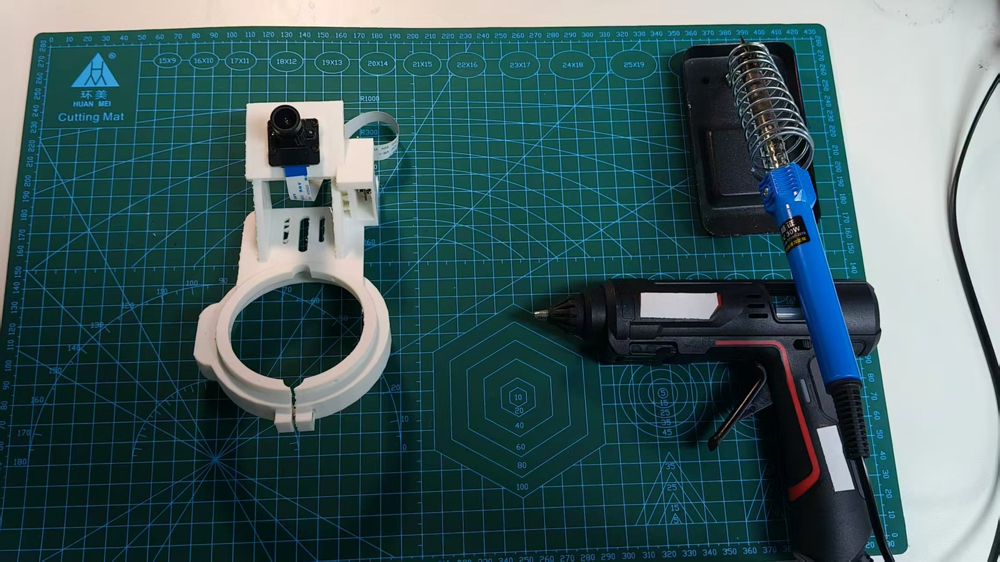
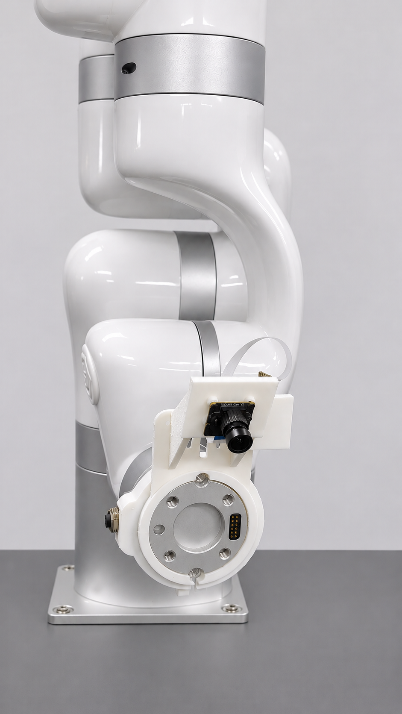

# Wrist Camera: A Low-Cost Wrist Camera for xArm7 Robot Learning

## Authors

<p align="center">
  <a href="https://github.com/wny24">Ningyue Wang</a>,
  <a href="https://github.com/luccachiang">Guangqi Jiang</a>,
  <a href="https://github.com/Cathyhhh64">Mengyu Chen</a>
</p>

## Affiliation

<p align="center">
  <a href="https://maureenzou.github.io/lab.html">IEI Lab, Tsinghua University</a>
</p>

Wrist Camera is a low-cost wrist-mounted RGB camera for **xArm7**, designed to provide a close-up view of the workspace for robot learning. It combines an SC3336 camera, a Luckfox Pico Mini board, and a 3D-printed mount to bring wrist-view observations to manipulation experiments and data-collection setups.

<table>
  <tr>
    <td width="76%" align="center" valign="top"></td>
    <td width="24%" align="center" valign="top"></td>
  </tr>
  <tr>
    <td align="center"><em>(a) Desktop assembly</em></td>
    <td align="center"><em>(b) Mounted on xArm7</em></td>
  </tr>
</table>

## Overview

This repository contains the hardware design and software for the wrist camera, including:

- A 3D-printable xArm7 wrist mount and editable CAD files.
- USB camera streaming and live visualization tools.

To build the camera, follow the **[Hardware Assembly Tutorial](docs/hardware-assembly-zh.md)**.

## Hardware Description

An SC3336 camera connects to a Luckfox Pico Mini over CSI. The board streams RGB video to the host through RTSP over USB ADB forwarding. A single printed mount holds both modules on the xArm7 wrist.

The current setup uses:

- Camera: Waveshare SC3336 3MP Camera.
- Processing board: Luckfox Pico Mini (RV1103).
- Mount: printed wrist ring with a camera plate and board holder.
- Connection: USB Type-C data cable.
- Tested output: 1920 × 1080 at approximately 30 fps, H.265.

See the [parts list and design files](docs/hardware-assembly-zh.md#bill-of-materials) to build your own. Video settings and measurement conditions are documented in the [1080p30 guide](docs/luckfox-30fps.md) and [benchmark results](docs/benchmark-results.md).

## Option 1 (Quick Start)

Use this path to preview a single assembled wrist camera. The host setup has been tested on Linux x86-64 with Python 3.12. Live preview requires a graphical desktop.

### 1. Prepare the camera

Follow the [assembly tutorial](docs/hardware-assembly-zh.md), install firmware matching your Luckfox board variant, and connect the board to the host using a USB data cable.

### 2. Install and create the uv environment

Install the Ubuntu system dependencies:

```bash
sudo apt install curl git adb ffmpeg fonts-dejavu-core python3-tk
```

If uv is not installed, install it using the [official installer](https://docs.astral.sh/uv/getting-started/installation/), then open a new terminal so the updated PATH takes effect:

```bash
curl -LsSf https://astral.sh/uv/install.sh | sh
```

In the new terminal, verify uv and clone the repository. If you already have a checkout, enter its root directory instead of cloning again.

```bash
uv --version
git clone https://github.com/IEILab/wrist-cam.git
cd wrist-cam
```

This project requires **Python 3.12**. Create its local virtual environment and install the locked dependencies:

```bash
uv venv --python 3.12
bash scripts/setup.sh
```

`uv venv` creates `.venv/` in the repository root and downloads a compatible Python interpreter if needed. The setup script runs `uv sync --locked` to install the versions recorded in `uv.lock`, creates `config.local.json` if missing, and checks imports for Tkinter, PyAV, NumPy, and RealSense. A successful setup prints `Python dependencies ready`.

Verify that the environment uses Python 3.12 and points to this checkout:

```bash
.venv/bin/python --version
.venv/bin/python -c "import sys; print(sys.executable)"
```

The executable path should end in `wrist-cam/.venv/bin/python`. **Activation is optional:** the project launchers use `.venv/bin/python` directly. For interactive work, you can activate the environment in Bash or Zsh:

```bash
source .venv/bin/activate
# Run Python commands in this environment.
# Leave it when finished:
deactivate
```

You can also use `uv run --locked python ...` without activation. There is no need to run `uv init` or create a separate Conda environment for this repository.

### 3. Configure the device

Replace the contents of `config.local.json` with your camera configuration. Find the serial with:

```bash
adb devices -l
```

Use that serial in the configuration:

```json
{
  "luckfox": [
    {"name": "Wrist camera", "serial": "YOUR_ADB_SERIAL", "port": 18554, "stream": 1}
  ]
}
```

Use `stream: 1` for the tested 1080p30 profile, or the stream index configured on your board. Device-specific configuration stays local and is ignored by Git.

### 4. Stream / visualize

```bash
bash scripts/play.sh
```

The launcher configures USB forwarding and opens the live camera viewer. See the [usage guide](docs/usage-zh.md) for multiple cameras and troubleshooting.

---

## Option 2 (Development Installation)

Use this path to modify the camera readers or visualization tools. Complete the camera setup and clone the repository as described above.

### 1. Install Python dependencies

From the repository root, install the locked environment, including development dependencies:

```bash
uv sync --locked
```

### 2. Configure the camera

Set the board serial, local port, and stream index in `config.local.json` as shown in Quick Start. Camera capture utilities are in `tools/`, and the viewer implementation is in `player/`.

### 3. Check USB forwarding

```bash
bash scripts/usb.sh
```

Use `bash scripts/usb.sh --watch` to keep monitoring and restoring forwards after disconnects.

### 4. Run the viewer and tests

```bash
bash scripts/play.sh
uv run pytest
```

For optional RealSense RGB comparison, see the [usage guide](docs/usage-zh.md). FPS measurement and frame pairing are covered in [benchmark results](docs/benchmark-results.md) and [timestamps](docs/timestamps.md). CAD and rendering instructions are in [hardware/](hardware/README.md).

## License

MIT — see [LICENSE](LICENSE).

The robot visualization meshes from [UFACTORY xarm_ros](https://github.com/xArm-Developer/xarm_ros) retain their original BSD 3-Clause license — see [hardware/licenses/UFACTORY-BSD-3-Clause.txt](hardware/licenses/UFACTORY-BSD-3-Clause.txt). Model provenance is documented in [hardware/](hardware/README.md#third-party-model-sources).

## Acknowledgements

- [Tsinghua University, IEI Lab](https://maureenzou.github.io/lab.html) — the lab where this project was developed; provided the research environment and advisor guidance.
- [Luckfox](https://wiki.luckfox.com/Luckfox-Pico-Plus-Mini/) and [Waveshare](https://wiki.luckfox.com/SC3336-3MP-Camera/) — the processing board, camera module, and hardware documentation used in this build.
- [UFACTORY xarm_ros](https://github.com/xArm-Developer/xarm_ros) — the robot meshes used in the assembly visualization.
