# Wrist Camera Hardware Assembly Guide

**A low-cost xArm7 wrist camera for robot learning · Hardware assembly guide**

Build a wrist-mounted RGB camera using an SC3336 camera, a Luckfox Pico Mini, and a one-piece printed mount. Follow the photographs below to assemble the camera on the bench, then install it on the xArm7 wrist.

<table>
  <tr>
    <td width="76%" align="center" valign="top">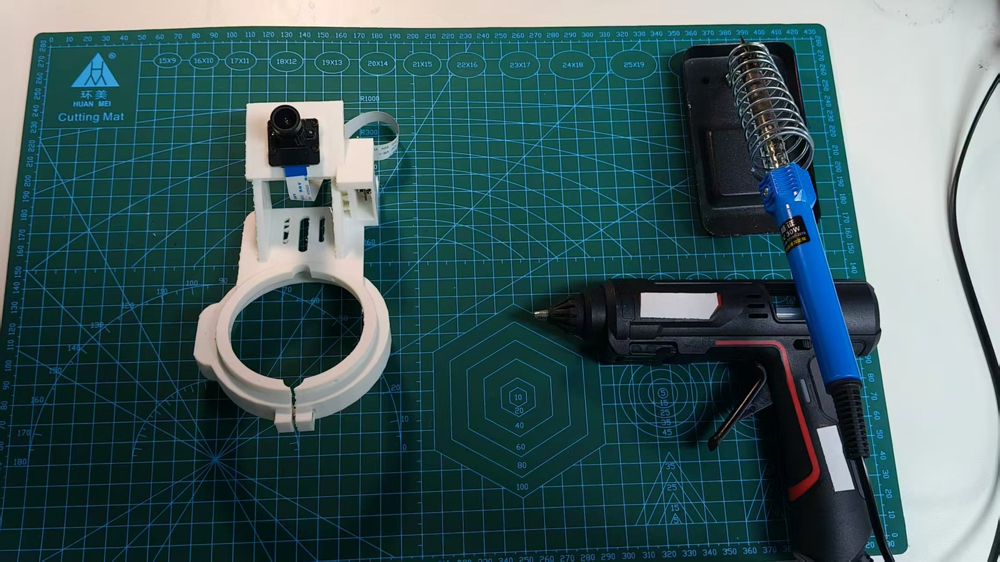</td>
    <td width="24%" align="center" valign="top">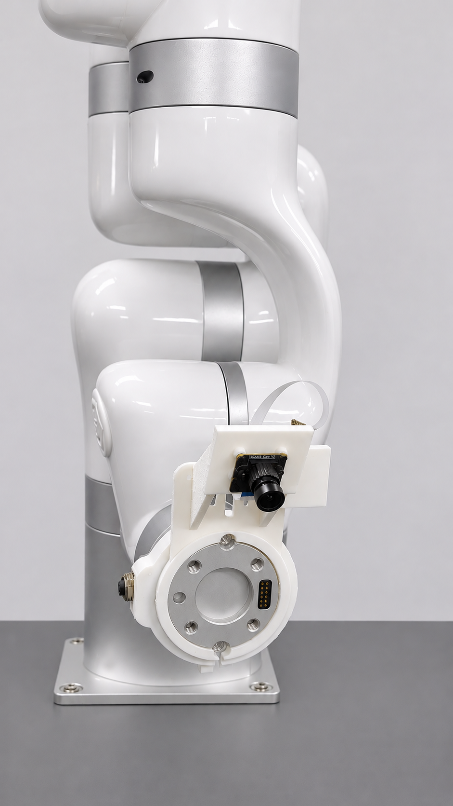</td>
  </tr>
  <tr>
    <td align="center"><em>(a) Desktop assembly</em></td>
    <td align="center"><em>(b) Mounted on xArm7</em></td>
  </tr>
</table>

## Resources

| Resource | Link |
| --- | --- |
| Hardware & Code | [Project home](../README.md) · [Hardware files](../hardware/README.md) |
| Software Guide | [Usage guide](usage-zh.md) · [1080p30 configuration](luckfox-30fps.md) |
| Hardware Reference | [SC3336 camera](https://wiki.luckfox.com/SC3336-3MP-Camera/) · [Luckfox Pico Mini](https://wiki.luckfox.com/Luckfox-Pico-Plus-Mini/) |
| Contact | [Project issues](https://github.com/IEILab/wrist-cam/issues); include the board variant, symptoms, and assembly photos |

## Bill of Materials

Quantities are for one wrist camera, excluding the robot arm, gripper, and host computer.

| ID | Part Name | Quantity | Link / Specification | Price / Unit |
| --- | --- | --- | --- | --- |
| **Camera and processing board** | | | | |
| 1 | Waveshare SC3336 3MP Camera | 1 | https://wiki.luckfox.com/SC3336-3MP-Camera/ | about $7 |
| 2 | Luckfox Pico Mini (RV1103) | 1 | https://wiki.luckfox.com/Luckfox-Pico-Plus-Mini/, variant B | about $13 |
| 3 | CSI ribbon cable | 1 | https://e.tb.cn/h.jTi83zp3CI29jCF?tk=TZFV6baraw3 | about $0.3 |
| **Mount and fasteners** | | | | |
| 4 | One-piece printed mount | 1 | [STL link](../hardware/cad/recessed_camera_plate.stl) | about $1.40 |
| 5 | M2 threaded inserts | 4 | M2 internal thread, 3.5 mm outer diameter, 4 mm length | about $0.11 |
| 6 | M2 machine screws | 4 | 2 mm thread diameter, 5 mm length | about $0.11 |
| 7 | M3 clamp bolt and nut | 1 each | 18 mm bolt length | about $0.11 |
| **Tools and supplies** | | | | |
| 8 | USB Type-C data cable | 1 | Data-capable cable long enough for the required motion range | Not listed |
| 9 | Hot-melt glue | As needed | Board retention, cable strain relief, and PCB insulation | Not listed |
| 10 | Soldering iron | 1 | Heat-set insert installation; use a tip suitable for the inserts | Not listed |
| 11 | Hot-glue gun | 1 | Apply small glue spots to secure the board | Not listed |

## Hardware Related Files

| Part / File | Link | Purpose |
| --- | --- | --- |
| Wrist mount | [STL](../hardware/cad/recessed_camera_plate.stl) | Ready for slicing and printing; units: mm |
| Editable mount | [STEP](../hardware/cad/recessed_camera_plate.step) | Modify the mounting geometry |

This design uses an off-the-shelf camera and processing board; no custom PCB is required. See the [hardware file guide](../hardware/README.md) for model dimensions and units.

## Camera Assembly Step-by-Step Guide

### Overview of Materials

Lay out the printed mount, camera, board, ribbon cable, and fasteners. Deburr the mount, test-fit the board, and check the four camera mounting holes. Keep power disconnected during assembly and when connecting or disconnecting the CSI ribbon cable.

  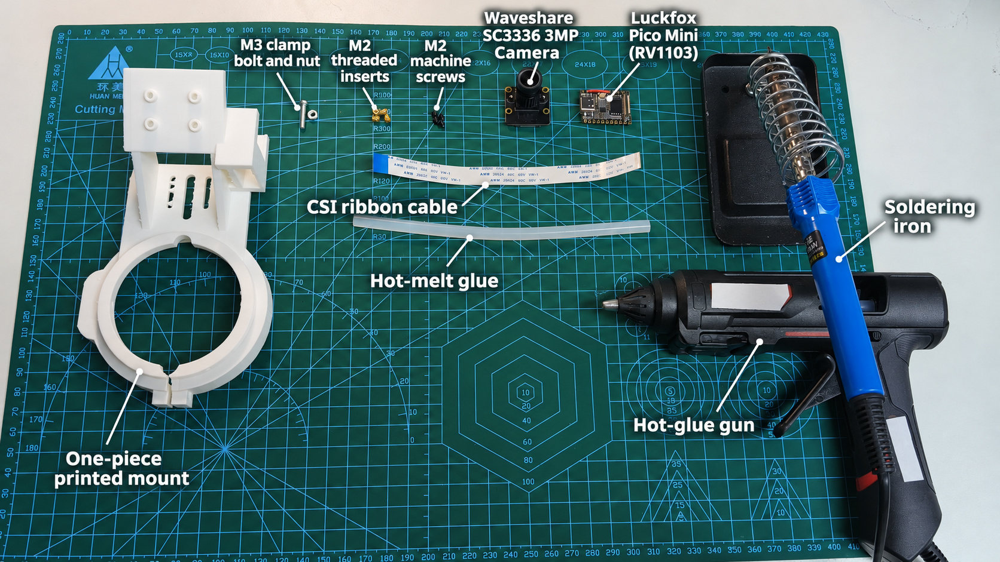
   <em>Figure 1 · Main components and assembly tools.</em>

### Step 1 — Connect the Camera and Board

Open the camera connector latch, insert the CSI ribbon cable straight, and close the latch. Then connect the other end to the board. Check the metal contact orientation at each end rather than relying only on the blue stiffener. For the Mini board, follow the [official CSI connection diagram](https://wiki.luckfox.com/Luckfox-Pico-Plus-Mini/CSI-Camera/).

<table>
  <tr>
    <td width="50%">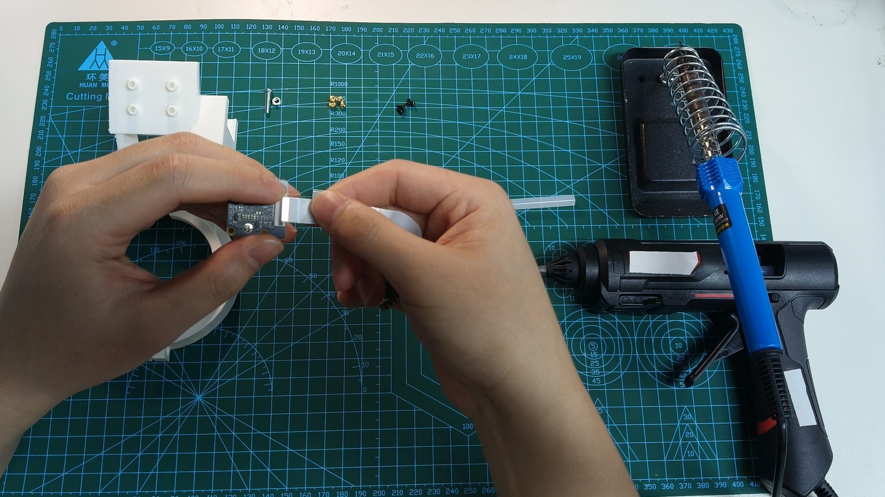</td>
    <td width="50%">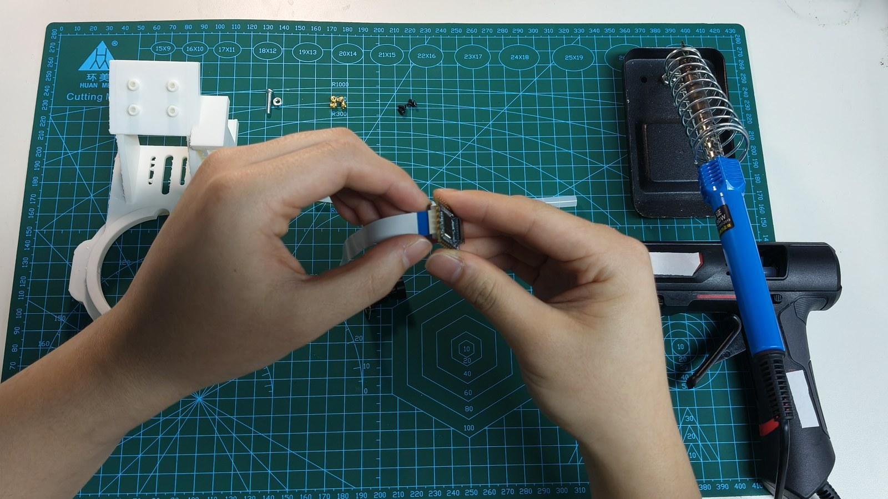</td>
  </tr>
  <tr><td align="center">Figure 2 · Connect the camera end.</td><td align="center">Figure 3 · Connect the board end.</td></tr>
</table>

### Step 2 — Install the Threaded Hardware

Install the four M2 inserts perpendicular to the camera plate, with their ends flush with the mounting surfaces. Place the M3 nut in the hexagonal recess on the side of the wrist ring, aligning it so the bolt threads in straight.

<table>
  <tr>
    <td width="50%">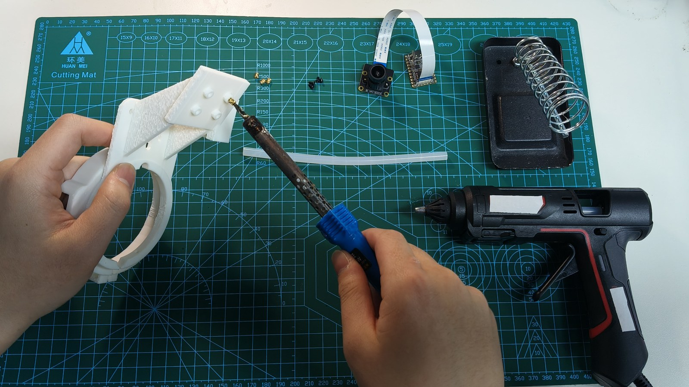</td>
    <td width="50%">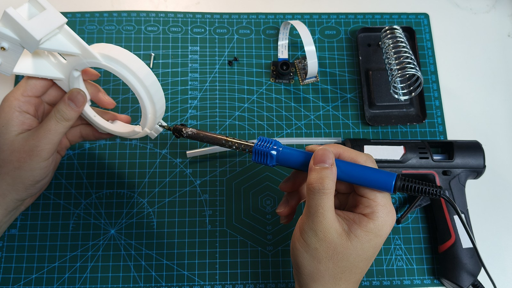</td>
  </tr>
  <tr><td align="center">Figure 4 · Install the camera plate inserts.</td><td align="center">Figure 5 · Position the wrist ring nut.</td></tr>
</table>

### Step 3 — Secure the Board

Test-fit the board in the side holder. Check that the USB plug can be fully inserted and that components do not touch the holder walls, then remove the board. Apply small glue spots where the holder meets the PCB edges. Put the board back, hold it in position, and let the glue cool completely.

<table>
  <tr>
    <td width="50%">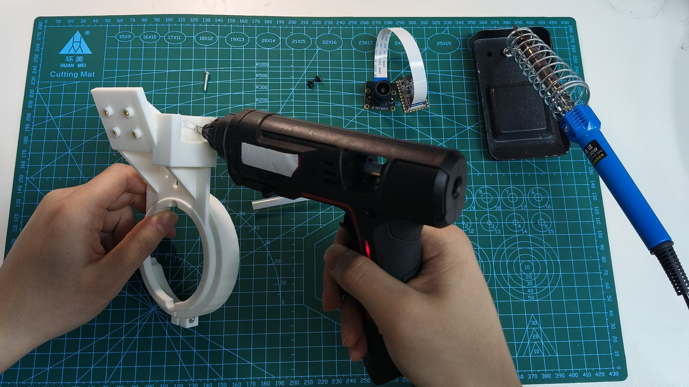</td>
    <td width="50%">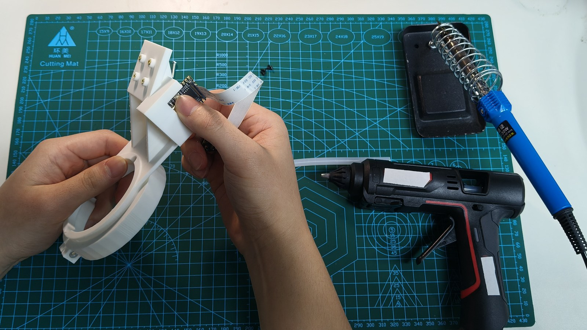</td>
  </tr>
  <tr><td align="center">Figure 6 · Apply glue at the contact points.</td><td align="center">Figure 7 · Position and secure the board.</td></tr>
</table>

### Step 4 — Mount the Camera

Point the lens toward the workspace and align the four holes with the camera plate inserts. Start all four screws loosely, then tighten them in a diagonal sequence until the camera no longer moves.

  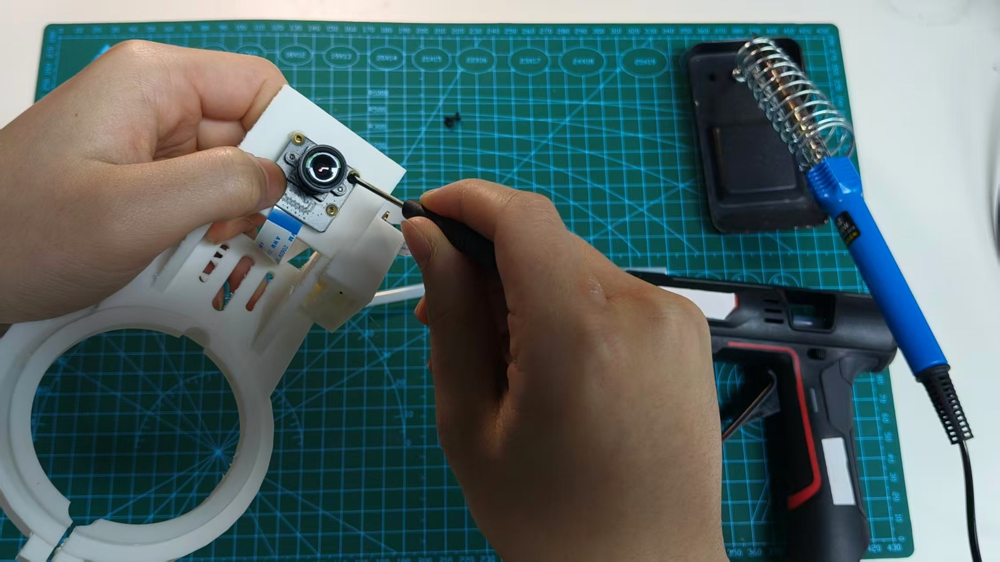
   <em>Figure 8 · Secure the camera without bending the PCB or pressing on components underneath.</em>

### Step 5 — Fit the Clamp Bolt

Insert the M3 bolt from the opposite side of the ring and thread it gently into the nut to check engagement. Leave it loose enough to slide the ring onto the wrist; do not tighten the clamp yet.

<table>
  <tr>
    <td width="50%">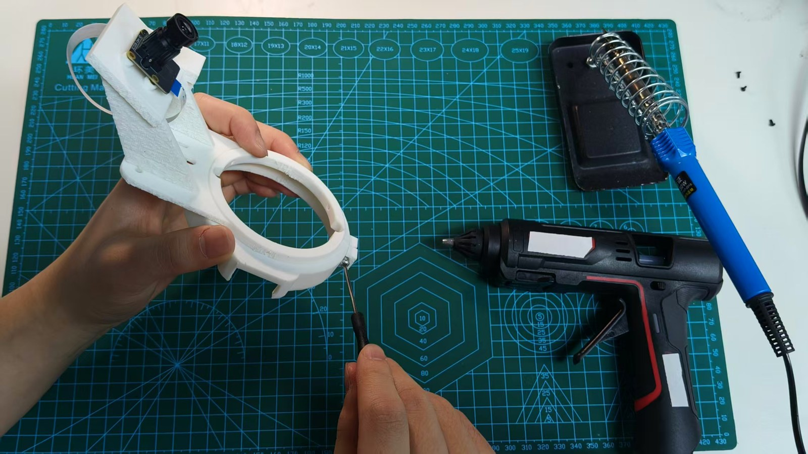</td>
    <td width="50%"></td>
  </tr>
  <tr><td align="center">Figure 9 · Fit the clamp bolt.</td><td align="center">Figure 10 · Bench assembly complete.</td></tr>
</table>

### Step 6 — Install on xArm7

After completing the bench assembly, install the camera assembly on the xArm7 wrist. The photos below show the final clamping operation and the installed wrist camera.

1. Stop the robot and disconnect power as required by the equipment instructions. Support the gripper, disconnect its cables, remove and retain the mounting screws, and take off the gripper.
2. Slide the large opening of the mount over the wrist from the gripper mounting end. Point the camera toward the workspace and align the opening so the wrist connectors remain accessible.
3. Adjust the position and slowly tighten the M3 bolt until the mount resists gentle rotation.
4. Connect USB and secure the cable with cable ties so that the connector and glue joints do not carry tension. Leave enough slack for wrist motion and keep the cable clear of the gripper and joint gaps.

<table>
  <tr>
    <td width="50%">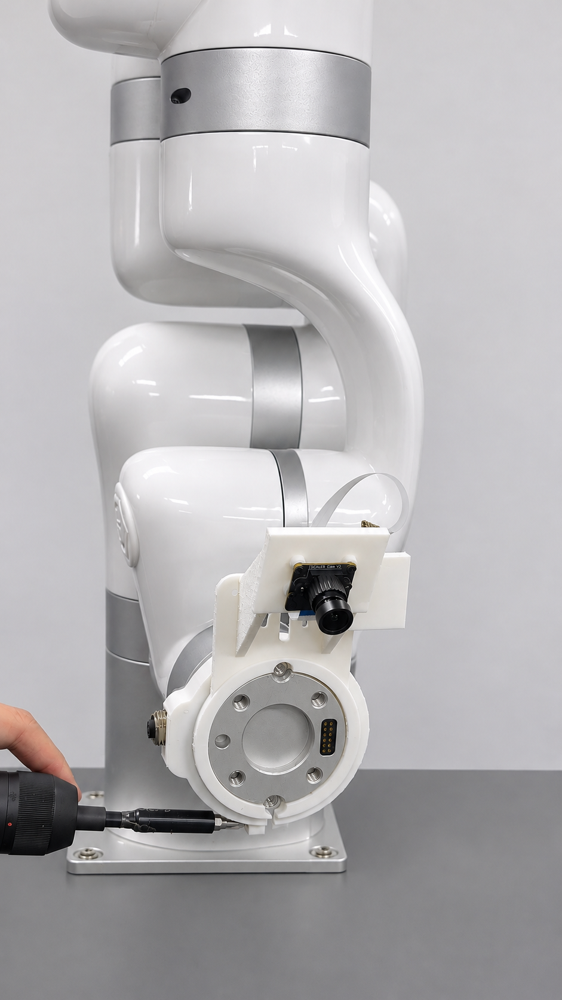</td>
    <td width="50%"></td>
  </tr>
  <tr><td align="center">Figure 11 · Final assembly step: tighten the wrist clamp.</td><td align="center">Figure 12 · Wrist camera installed.</td></tr>
</table>

The photos show the secured camera mount before the gripper is reattached and the USB cable is connected. Complete end-effector installation and cable routing before use.

## Troubleshooting

| Symptom | Checks and fixes |
| --- | --- |
| Board detected, but no video | Disconnect power and check both CSI connectors and latches; verify the board service and `stream` setting |
| Camera moves or PCB bends | Check for spinning inserts, bottomed-out screws, or pressure on components underneath |
| Board is loose or USB plug cannot fully seat | Disconnect power, adjust the board position and glue spots, clear the port, and secure the board again |
| Mount rotates or gripper mounting faces do not sit flush | Check the ring position, clamp nut, and mechanical interference; do not force the fasteners |
| Connection drops during wrist motion | Check USB cable retention and slack; avoid pulling on connectors or the ribbon cable |
| Image is out of focus | Rotate the lens manually to adjust focus |

For software diagnostics, see the [usage guide](usage-zh.md). For frame-rate issues, see the [benchmark results](benchmark-results.md).

---
