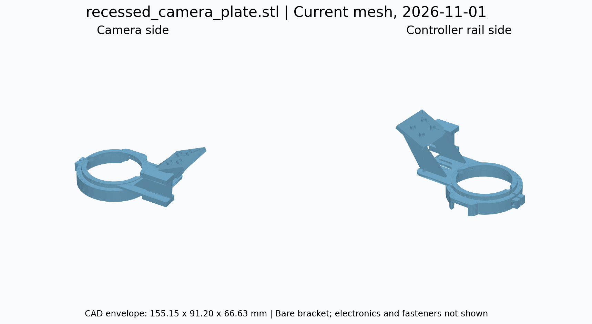
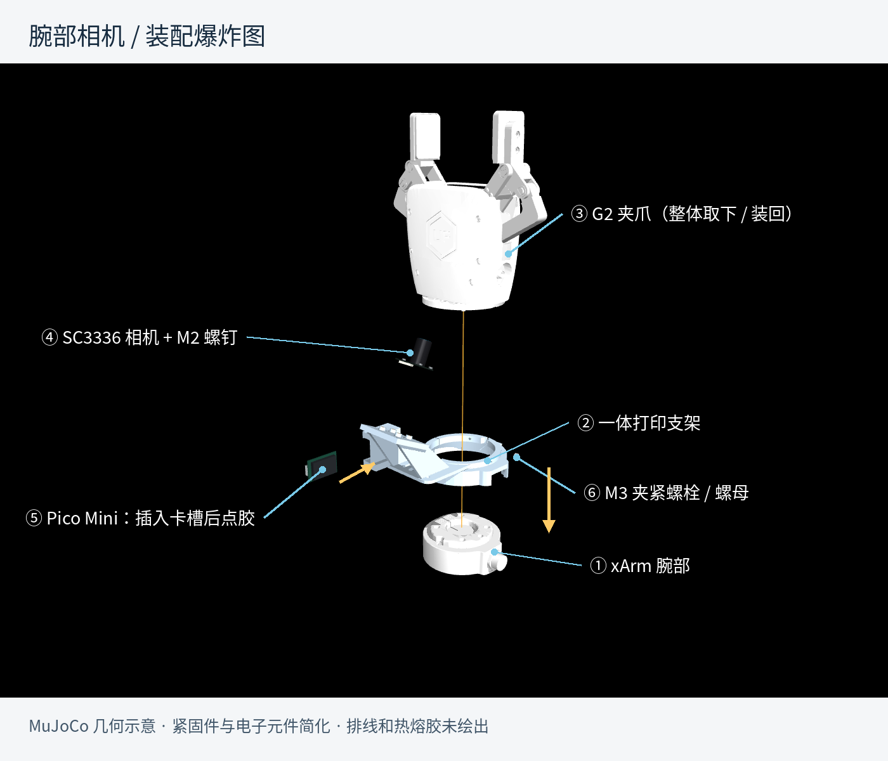
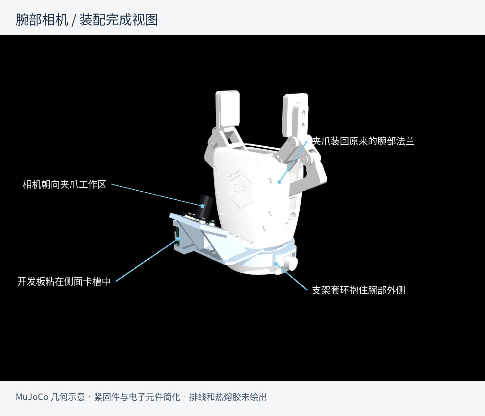

# Wrist Camera 硬件组装指南

将 **Waveshare SC3336 3MP Camera + Luckfox Pico Mini（RV1103）** 安装到 xArm / G2 夹爪腕部。相机用螺钉固定，开发板用热熔胶粘在侧面卡槽中。

[硬件文件与仿真说明](../hardware/README.md) · [软件使用说明](usage-zh.md)

## 1. 准备物料

数量按一套计算。相机与 Mini 的 A/B 子版本尚未记录，购买前请核对下节尺寸及接口。

| 物料 | 数量 | 规格 |
| --- | --- | --- |
| 一体打印支架 | 1 | [STL](../hardware/cad/recessed_camera_plate.stl) / [可编辑 STEP](../hardware/cad/recessed_camera_plate.step) |
| 摄像头 | 1 | [Waveshare SC3336 3MP Camera](https://wiki.luckfox.com/SC3336-3MP-Camera/)，彩色 CSI 模块 |
| 开发板 | 1 | [Luckfox Pico Mini（RV1103）](https://wiki.luckfox.com/Luckfox-Pico-Plus-Mini/)，按 A/B 版本准备启动介质和固件 |
| CSI 排线 | 1 | 优先使用相机配套线，确认针数、间距及触点方向 |
| USB 数据线 | 1 | 开发板端 Type-C，支持数据传输 |
| M2 螺纹嵌件 | 4 | 内螺纹 M2、外径 3 mm、长 6 mm |
| M2 机螺钉 | 4 | 长度按 PCB、必要的绝缘垫片和嵌件深度选择，不能顶底 |
| M3 夹紧螺栓、螺母 | 各 1 | 用于腕部套环，长度按实物选择 |
| 热熔胶、扎带 | 适量 | 固定开发板和 USB 线 |

工具：胶枪、卡尺、匹配的螺丝刀/内六角扳手、去毛刺工具，以及与嵌件类型匹配的安装工具。

## 2. 打印与试装

支架的大环套在腕部，倾斜四孔座安装相机，侧面卡槽放开发板。三者为一个打印件。

STL 单位为 **mm**，导入切片软件后的原始 XYZ 尺寸应为 **155.15 × 91.20 × 66.63 mm**。以下是 CAD 设计值，打印前用实物核对：

| 部位 | 尺寸 |
| --- | --- |
| 相机 PCB / 四孔中心距 | 25 × 24 × 1.2 mm / 21 × 13.5 mm |
| 相机背面留空 | 3 mm，器件和接头不能受压 |
| 嵌件孔 | 直径 3 mm、深 6.2 mm，先用样块验证配合 |
| 开发板外包络 | 30 × 20 × 8 mm，包含元件厚度 |
| 开发板卡槽 | 宽 22.8 mm、高 8.4 mm |

[相机孔距与嵌件剖面图](assets/hardware/camera-mount-dimensions.png)

可用 PETG、0.2 mm 层高、4 道壁、约 40% 填充作为首件试打起点，按打印机调整层向和支撑；这些参数尚未经过实物验证。打印后去除毛刺，确认四孔对齐、开发板能放入且元件不碰槽壁。

## 3. 分步组装

### A. 桌面接线，确认出图

1. **断电连接 CSI 排线。** 均匀打开锁扣，平直插入排线后锁好。Mini 板端蓝色加强片朝芯片侧；以[官方 Mini 接线图](https://wiki.luckfox.com/Luckfox-Pico-Plus-Mini/CSI-Camera/)和实际触点为准，相机端单独核对。
2. 接 USB，按 [软件使用说明](usage-zh.md)配置序列号并运行 `bash scripts/play.sh`。新板先按[官方烧录说明](https://wiki.luckfox.com/Luckfox-Pico-Plus-Mini/Flash-image/)安装对应固件。
3. 确认画面持续更新，再断电进行机械安装。本项目通过 ADB 转发 RTSP 取流，RealSense 仅用于可选对比。

### B. 安装嵌件

1. 在支架四个相机安装孔中安装 M2 嵌件，保持垂直、端面齐平。热熔安装时先用样块确定温度和压入量。
2. 完全冷却后，用螺钉轻拧检查：嵌件不跟转，支撑柱不开裂。

### C. 固定相机

1. 镜头朝向工作区，四孔对准嵌件，给排线接头留出操作空间。
2. 按「螺钉 → 必要的绝缘垫片 → PCB → 嵌件」安装，四颗螺钉先轻旋入，再交叉拧紧至相机不晃动。
3. 确认 PCB 平整、背面器件不受压。螺钉长度应有足够啮合且不顶底；**嵌件长 6 mm 不代表应选 M2×6 螺钉**。

### D. 用热熔胶固定开发板

1. 断电后将开发板放入侧面卡槽，USB 朝方便插线的一端。试插 USB，确认插头能到底，再拔下。
2. 接好 CSI 排线，留自然弯曲的余量。在 **PCB 边缘与槽壁接触处**点少量热熔胶，先固定一侧，冷却后补另一侧。
3. 胶枪嘴不碰 PCB，胶不覆盖芯片、接口、锁扣和按键。完全冷却后轻推板子，确认不滑动。

### E. 安装到机械臂腕部

图中：① 腕部、② 支架、③ G2 夹爪、④ 相机、⑤ 开发板、⑥ M3 夹紧螺栓与螺母。箭头表示支架套入和开发板插入方向。

1. **取下夹爪。** 机械臂停止并按设备要求断电，托住夹爪，断开连线，拆下原固定螺丝。夹爪整体取下，保留螺丝。
2. **套入支架。** 从夹爪安装端将大圆孔套过腕部前端，转到相机朝工作区、窗口露出腕部接口的位置，再轻推到位。不要掰开套环从侧面硬扣。
3. **夹紧套环。** M3 螺母放入侧面六角槽，从另一侧穿入螺栓，慢慢拧到支架轻推不转，避免拧裂塑料。
4. **装回夹爪。** 对准原安装面，用原螺丝按厂商要求固定，接回连线。若支架顶住夹爪、安装面无法贴合，取下检查，不要靠螺丝硬压。

图为 MuJoCo 几何示意，排线和胶点未绘出；紧固件外形简化，不能据此确定螺丝长度或判定无干涉。场景与复现方法见 [hardware/](../hardware/README.md)。

### F. 固定线缆

用扎带将 USB 线固定到支架或邻近结构，让插座和胶点不承受拉力。腕部活动处留足余量，避免线缆进入夹爪或关节缝隙。

## 4. 上机检查

- [ ] 相机、开发板和支架均不松动，胶已冷却，PCB 无弯曲或器件受压。
- [ ] CSI 两端锁紧，USB 插到底，排线无死折，线缆不绷紧。
- [ ] 夹爪安装面贴合，支架不挡接口，不碰夹爪及运动件。
- [ ] 在工作距离对焦，图像方向正确，关键视场无遮挡。
- [ ] 建议连续预览 10 分钟，再低速、无负载检查任务所需姿态及夹爪开合；出现掉线、拉扯或滑移立即停止。

照片、序列号、固件版本和装配记录可存入本地 `output/`。需要相机外参的任务，应在最终锁紧后标定；改变安装姿态后重新检查。

取流问题见 [软件使用说明](usage-zh.md)，1080p30 设置见 [帧率配置](luckfox-30fps.md)。
